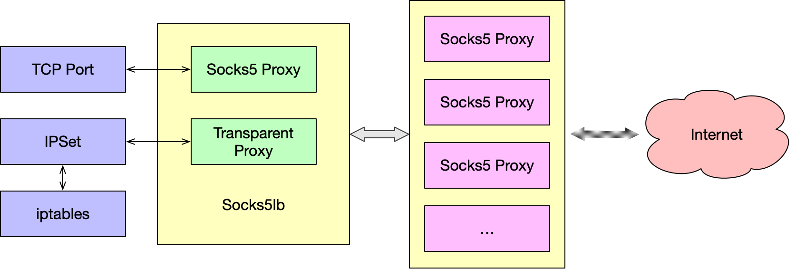

# socks5lb - Simple SOCKS5 Proxy Load Balancer



Sometimes SOCKS5 proxies become unreachable due to network fluctuations or routing changes, requiring manual node switching which can be tedious and time-consuming.

This tool solves that problem by acting as a front-end load balancer for SOCKS5 proxies, automatically routing traffic through verified, healthy proxy nodes.

The library also retains a deprecated Linux transparent proxy API with SOCKS5 protocol conversion. It is not started by the CLI or `Server.Start`.

## Key Features

- **Load Balancing**: Round-robin distribution across SOCKS5 proxies with automatic health checks
- **Legacy Transparent Proxy API**: Linux [TPROXY](https://www.kernel.org/doc/Documentation/networking/tproxy.txt) support with SOCKS5 protocol conversion; deprecated and opt-in for library callers
- **Cross-Platform**: Written in Go for easy deployment across platforms (including routers)

## Changelog

- `2026-10-26` Version 1.3.0: Added automated GitHub Releases with GoReleaser, providing Linux, macOS, and Windows binaries for amd64 and arm64, bundled example configuration, and SHA-256 checksums.
- `2025-10-07` Refactored codebase to update copyright information, improve health check mechanisms, and enhance concurrency handling with atomic operations and mutexes. Bump Go version to 1.25 and optimize HTTP server configurations.
- `2022-07-16` Fixed connection performance issues, added HTTP management interface
- `2022-07-06` Completed Linux transparent gateway functionality
- `2022-06-20` Initial release with core features

## Building

The Go toolchain is managed by [mise](https://mise.jdx.dev/). The version in
`mise.toml` matches `go.mod` (Go 1.26.8); use the project toolchain for development:

```bash
mise install
mise exec -- make build
```

This produces `./socks5lb`. Docker Compose is also supported:

```bash
docker-compose build
```

## Configuration

Here's a basic configuration example with three SOCKS5 proxies exposed on local port 1080:

```yaml
server:
  http:
    addr: ":8080"
  socks5:
    addr: ":1080"
backends:
  - addr: 192.168.100.254:1086
    check_config:
      check_url: https://www.google.com/robots.txt
      initial_alive: true
      timeout: 3
  - addr: 10.1.0.254:1086
    check_config:
      check_url: https://www.google.com/robots.txt
      initial_alive: false
      timeout: 30
  - addr: 172.16.100.254:1086
    check_config:
      check_url: https://www.google.com/robots.txt
      initial_alive: true
      timeout: 3
```

`server.socks5.addr` is required by the CLI. An empty or `null` configuration
file, invalid backend addresses (empty or whitespace-only), and duplicate
backend addresses are rejected during initialization.

Backend `username` and `password` fields are preserved for authenticated health
checks and the legacy transparent proxy API. The normal SOCKS5 listener forwards
the client's SOCKS5 negotiation unchanged; clients must supply any credentials
required by the selected upstream.

`initial_alive` takes effect immediately for configured and dynamically added
backends. With a `check_url`, periodic HEAD requests mark HTTP 2xx/3xx responses
healthy and do not follow redirects. `timeout` is in seconds and defaults to 10;
it bounds the health request, including SOCKS5 negotiation. Without `check_url`,
the backend retains its configured `initial_alive` policy.

### Cross-platform connection and health-check options

These settings work on Linux, macOS, and Windows. Existing configurations retain
unlimited proxy connections and concurrent dials, one dial attempt with a
10-second budget, and serial health checks starting at the first timer tick.
The following example explicitly enables additional protection:

```yaml
server:
  socks5:
    addr: ":1080"
  connections:
    max_connections: 1000
    max_concurrent_dials: 32
    dial_attempts: 2
    dial_timeout: 10
  health_check:
    concurrency: 4
    check_on_start: true
    jitter_percent: 10
    failure_threshold: 2
    success_threshold: 2
```

| Setting | Default | Meaning |
| --- | --- | --- |
| `connections.max_connections` | `0` | Maximum active proxy tunnels per server; `0` is unlimited. Excess accepted connections are closed before dialing an upstream. The HTTP management listener is not counted. |
| `connections.max_concurrent_dials` | `0` | Maximum concurrent normal SOCKS5 backend-dial operations; `0` is unlimited. Waiting consumes the dial budget and is canceled during shutdown. |
| `connections.dial_attempts` | `1` | Maximum dial attempts against distinct healthy backends; `0` also means one. Retries only occur before any client bytes are forwarded. |
| `connections.dial_timeout` | `10` | Total dial budget in seconds, including queueing, DNS, and all attempts; `0` uses 10 seconds. It does not limit an established tunnel's lifetime. |
| `health_check.concurrency` | `1` | Maximum simultaneous server-managed probes; `0` also means one. Separate rounds never overlap. |
| `health_check.check_on_start` | `false` | Schedule an immediate asynchronous check instead of waiting for the first tick. This does not delay accepting connections until checks finish. |
| `health_check.jitter_percent` | `0` | Add a random delay of up to this percentage of `CHECK_TIME_INTERVAL` before each periodic round; range `0` through `100`. |
| `health_check.failure_threshold` | `1` | Consecutive failed probes needed to mark a backend unhealthy; `0` also means one. |
| `health_check.success_threshold` | `1` | Consecutive successful probes needed to mark a backend healthy; `0` also means one. |

An opposite probe result resets the consecutive-result counter. Probe failures
are logged even before the threshold is reached. A canceled check does not
change health. Backends without `check_url` continue to follow `initial_alive`,
without thresholds. Removing and re-adding a backend resets its check history.
Direct library calls to `Backend.Check` and `Pool.Check` retain their immediate
health-update semantics; the options above govern checks scheduled by `Server`.

Retries do not replay SOCKS5 authentication, requests, or established traffic,
and do not permanently mark a backend dead based on a single dial failure.
The deprecated transparent listener does not use the normal SOCKS5 dial retry
or dial-limit settings. Its routing behavior is otherwise unchanged.
Configuration must not be modified concurrently with a running server; set
server options before `NewServer`. Replace backend configuration by deleting
and re-adding the backend rather than mutating a published backend.

### Environment Variables

- `SELECT_TIME_INTERVAL` - Backend switching interval for the deprecated `ListenTProxy` API only (default: 300 seconds / 5 minutes). Normal SOCKS5 connections use round-robin selection per connection.
- `CHECK_TIME_INTERVAL` - Health check polling interval in seconds (default: 60 seconds / 1 minute)
- `DEBUG` - Enable debug mode (true/false)

## Deployment

### Docker Compose

It's recommended to use `network_mode: 'host'` to avoid network connectivity issues caused by Docker's iptables rules:

```yaml
version: "3"
services:
  socks5lb:
    image: ghcr.io/mingcheng/socks5lb:latest
    restart: always
    dns:
      - 8.8.8.8
      - 8.8.4.4
    environment:
      TZ: "Asia/Shanghai"
      CHECK_TIME_INTERVAL: 3600
    network_mode: "host"
    privileged: true
    volumes:
      - ./socks5lb.yml:/etc/socks5lb.yml:ro
```

### iptables Configuration

The CLI does not start the deprecated transparent proxy listener, and setting
`server.tproxy.addr` alone does not enable it. Library users must explicitly call
`ListenTProxy` on Linux with the required network capabilities. IPv4 original
destination lookup is supported.

For an explicitly started listener on port 8848, example iptables rules follow
(the `redrock` ipset must be configured separately):

```shell
iptables -t nat -I PREROUTING -p tcp -m set --match-set redrock dst -j REDIRECT --to-ports 8848
iptables -t nat -I OUTPUT -p tcp -m set --match-set redrock dst -j REDIRECT --to-ports 8848
```

## Web Management API

Version 1.1.0 introduced a simple web management interface for dynamic proxy configuration:

The management API has no built-in authentication. Bind it to a trusted
interface or protect it with an authenticated reverse proxy.

### GET `/version`

Returns current version, build time, and uptime information.

### GET `/api/all`

Lists all configured proxy servers in address order. Add `?healthy=true` to show
only healthy backends. Invalid boolean filter values return HTTP 400.

### PUT `/api/add`

Adds new proxy backends. The request body should be a JSON array of backend configurations:

```json
[
  {
    "addr": "192.168.1.254:1086",
    "check_config": {
      "check_url": "https://www.taobao.com/robots.txt"
    }
  },
  {
    "addr": "192.168.1.254:1087",
    "check_config": {
      "initial_alive": true
    }
  }
]
```

Returns the number of backends successfully added. Additions are atomic: if an
address already exists or is duplicated within the request, HTTP 503 is returned
and the pool is unchanged. Existing backends must be deleted before re-adding.
Malformed JSON, missing addresses, and empty or `null` batches return HTTP 400.

Example using curl:

```
curl -X "PUT" "<your-address>/api/add" \
     -H 'Content-Type: text/plain; charset=utf-8' \
     -d $'[
  {
    "addr": "192.168.1.1:1086",
    "check_config": {
      "check_url": "https://www.taobao.com/robots.txt"
    }
  }
]'
```

### DELETE `/api/delete`

Removes a specific proxy backend by address using the `addr` query parameter:

```
curl -X "DELETE" "http://localhost:8080/api/delete?addr=192.168.1.1:1086"
```

## Testing and performance

Use the pinned Go toolchain, `gofmt`, `go vet`, and the existing test/race targets:

```sh
mise exec -- make check
mise exec -- go test -run '^$' -bench 'Benchmark(PoolNext|BackendDial|Transport)' -benchmem -count=5 .
```

The benchmarks cover serial/parallel selection at different backend counts,
backend TCP connection establishment, and round-trip TCP forwarding with
different payload sizes. Reported forwarding
bytes count both directions. Compare results on the same machine with matching
CPU limits, Go versions, payloads, and concurrency; these loopback benchmarks
are not predictions of WAN throughput or production connection capacity.
Allocation assertions run without `-race`, because race instrumentation
intentionally discards `sync.Pool` entries; functional/concurrency tests still
run with the race detector.
Use Go's benchmark CPU/memory profiling flags and `go tool pprof` when needed.
For deployment load tests, also record active connections, descriptors/handles,
RSS, connection-establishment p95/p99, and recovery time after backend failures.

The hot path preserves `io.WriterTo`/`io.ReaderFrom` and TCP half-closes, so Go can
use OS-specific optimizations (including Linux `splice`) and its portable
fallbacks. User-space copy buffers are borrowed only when neither fast-copy
interface exists. Avoid wrappers that hide those interfaces or `CloseWrite`.
Pool membership is sorted only when it changes; selection reuses temporary
storage while reading the current atomic health state.

## FAQ

### How do I disable health checks for a specific backend?

Leave the `check_url` parameter empty and set `initial_alive` to `true`:

```yaml
backends:
  - addr: 127.0.0.1:10860
    check_config:
      initial_alive: true
```

### Can I use the tproxy_listen configuration on non-Linux systems?

No, transparent proxy support is Linux-only. Leave the tproxy configuration empty on other platforms.

### Are there similar projects?

- https://github.com/ginuerzh/gost
- https://github.com/nadoo/glider

## License

MIT License - see [LICENSE](LICENSE) file for details.
